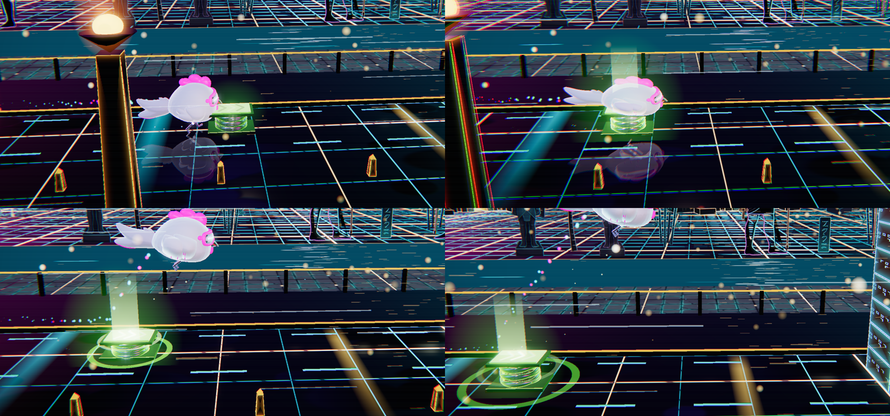
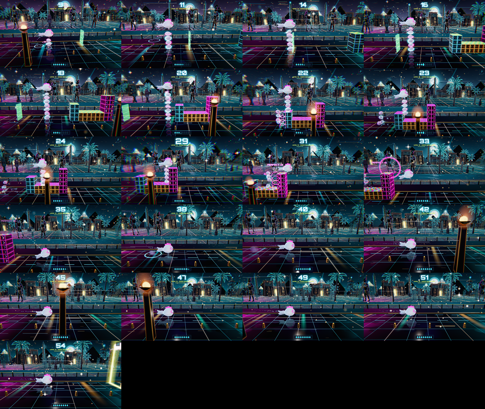
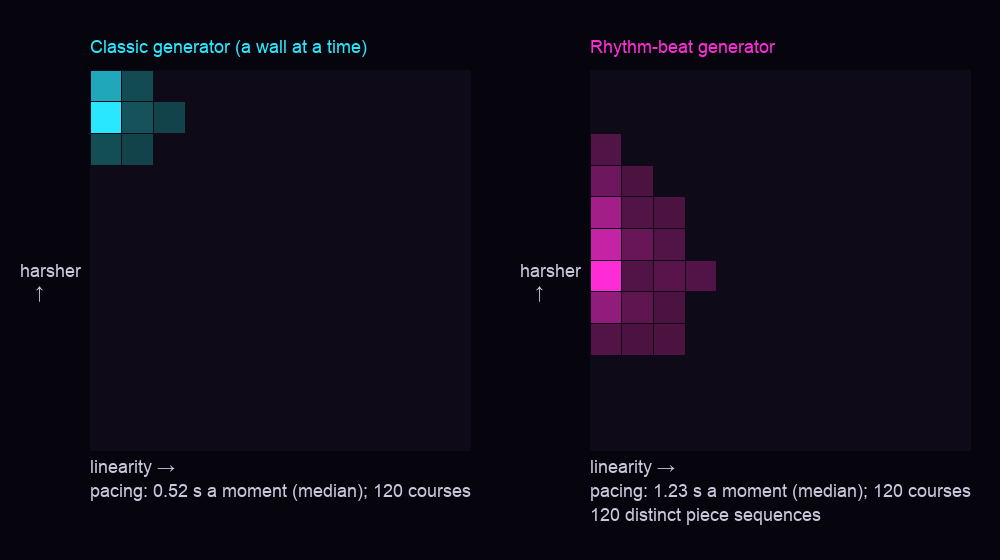
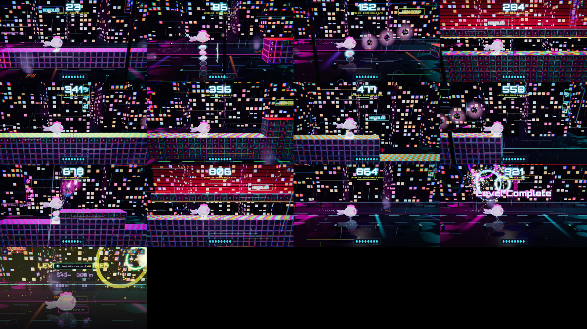
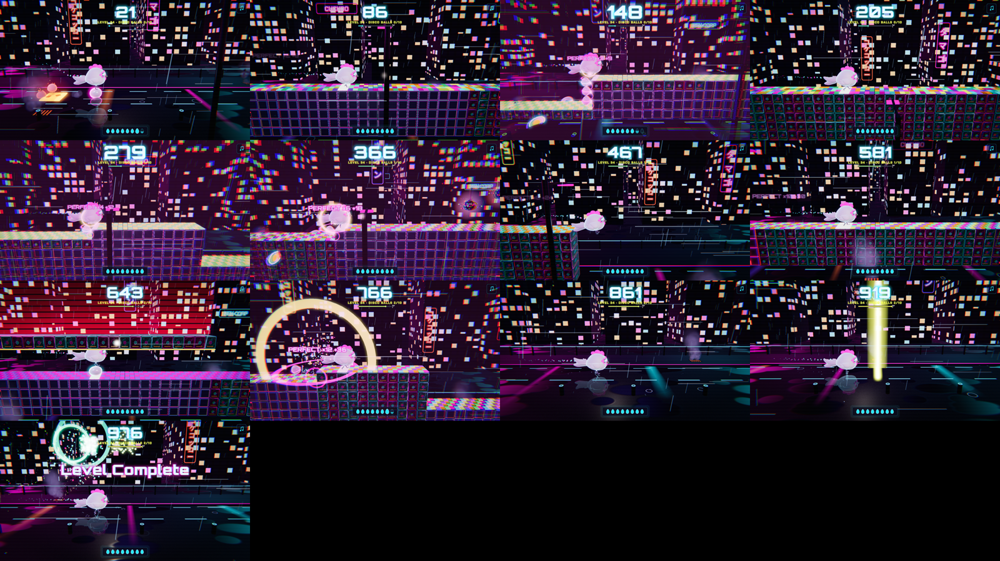
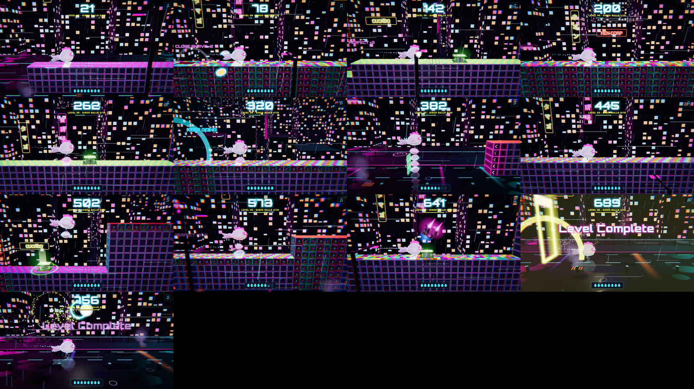

# Level design log

The campaign grows to level 100: 10 zones of 10 levels. The neon city (1–10), Neon Egypt (11–20) and Neon Japan
(21–30) exist. This log records what each level and gauntlet is built around, so no idea repeats as the zones are
added.

## Principles (every level from 11 on)

- **No two alike.** No level layout and no gauntlet is ever reused, mirrored included. Each level is built around its
  own signature moment, the one players remember ("the saw shaft on 14").
- **Near misses on purpose.** Tension comes from what almost gets you: a saw that takes the last egg right under the
  hen, a barrier that clears her comb, a landing just past a blade. Every one has a fair way through and is readable
  in time: telegraphed at least 0.6 s ahead at the level's speed.
- **Teach, test, twist.** A new mechanic first appears alone and safe, then under pressure, then turned on its head.
- **Pacing.** Tension, then release: a hard stretch is followed by a breather, and a level ends on its hardest idea
  before a clear run to the finish.
- **Proven clearable.** Every level and gauntlet is played through by the bot in a test before it ships
  (`GameDev_test refillKeepsUp`; the gauntlet solver for mazes).

## Hazards, one more per zone

| Zone | Levels | Hazard it brings | Status |
| --- | --- | --- | --- |
| Neon city | 1–10 | walls, barriers, drops; the droid's raids (from 5) | live |
| Neon Egypt | 11–20 | saw blades | live |
| Neon Japan | 21–30 | wall lasers; lava | built (the user places them on authored levels) |

Each zone keeps the hazards of the zones before it.

## Saw blades (levels 11 on)

A spinning blade set into the course, its top half above the surface. Crossing it slices the bottom egg off the
stack, once per blade; with no egg under her it kills the hen. Code: `Level::placeSaw` (where), `GameSaw.cpp` (what
happens, how it looks).

- **Rows of blades:** saws also come back to back, about 1.8 m apart, each sawing off an egg in turn (so a row of
  three needs three, the last taken right under the hen). None on levels 11 and 12, rows of up to 2 from 13, up to 3
  from 16 (`Campaign::sawRowOf`).
- **Floor saws** sit in the street or a stone wall's top. **Cube saws** sit in the top of a cyber-cube wall, a beat
  past its front edge: the climb onto it lands, then the blade. A "perfect" climb (exactly enough eggs) leaves none
  for the blade, so a cube saw turns the perfect habit into a trap. That's the twist.
- **The near miss they're built for:** a careful stack has one egg to spare at the blade, and the blade takes it
  right under the hen. That pays out as a **CLOSE SHAVE** (a close call: +2, the close-calls mission), with a beat of
  slow motion.
- **Telegraphs:** a whine about a second out; the blade glows red-hot from afar and strobes white-hot when the hen
  would reach it with no egg under her; her visor turns red.
- **Fairness rules** (`Level_test saws`):
  - each saw has its own flat stretch, lengthened to fit, and the stack meets it on level ground;
  - never under a barrier, and a reaction (speed × 0.6 s) after leaving one;
  - past the landing from a drop, and a reaction after it;
  - a reaction's run after it (speed × 0.45 s) before the next wall;
  - one egg's refill and a reaction from the last saw (or row);
  - the egg budget charges each blade an egg, so a careful player always has them with eggs to spare.
- **Teach:** every course's first saw is a lone blade on the street (the course drops to the street for it), and on
  a level with a gauntlet it comes before the gauntlet: one new thing at a time.
- **Interactions:** OVERDRIVE smashes blades off their slots; the droid never zaps an egg a saw just ahead needs, nor
  the egg being sawn.
- **Numbers** (`Campaign::sawsOf`, blades on the run; a gauntlet's own come on top): none before level 11, then 2
  rising to 8 by level 20, 8 from then on.

| Level | 11 | 12 | 13 | 14 | 15 | 16 | 17 | 18 | 19 | 20 | 21+ |
| --- | --- | --- | --- | --- | --- | --- | --- | --- | --- | --- | --- |
| Saws | 2 | 2 | 3 | 4 | 4 | 5 | 6 | 6 | 7 | 8 | 8 |

- **Developer menu:** "Next run: saws" puts about one saw per 25 m on the next run, on any level.

## Wall lasers and lava (any level)

Both are in every level's tool set: on an authored level they are where the user puts them; on a level without an
authored file the course generator places them (`Level::placeLaserOrLava`, counts `Campaign::lasersOf` /
`lavaOf`, charged to the egg budget). Code: `hazards/Laser.cpp` / `Lava.cpp` (the rows), `GameLaser.cpp` /
`GameLava.cpp` (play and look).

- **Wall laser** (`lasers`: `x row dir`): a turret set into a wall's or a block's side (x a column's edge), its beam
  `row` eggs up from the street, firing left (`dir` 0) or right (1) along the course as far as the first solid cell
  in that row (16 m at most). As she comes near it charges (a laser pointer's line and dot, a split second), then
  fires a thick beam. It hits her once a pass, the first time its row meets her: an egg there is cut in half (the eggs
  above drop; the one right under her: CLOSE SHAVE), her body there cuts her in half; just over her head: CLOSE CALL.
  Falling down through its row, her bottom egg meets it first. The generator sets them in a drop's face (she falls
  through: an egg).
- **Lava** (`lava`: `x len`): `len` cells (0.6 m each) of molten floor on the street or a wall top. Each cell she
  crosses burns the egg under her; with none, she burns up. Stack `len` eggs before it (the last: CLOSE SHAVE).
- **In mazes:** `(` stone with a laser in its left side (fires left), `)` in its right side (fires right), `~` a lava
  floor cell; the same rules.

## Springs and bouncers on the course

- **Spring** (`springs`: `x power`): a pad that launches her, stack and all, `power` rows up (2 to 12) with her speed kept.
  - She flies over what's ahead with no eggs and lands where the arc comes down (`CourseRules.h` `springFlight`: the game's own physics).
  - Its front meeting a wall's face below her feet crashes her; so does her head meeting a barrier.
  - The checker flies it at every speed she may run at (0.8 to 1.24 of the curve's). It notes a crash, a landing too short to react on, and a spring off the flat or too soon after a drop.
  - What it flies her over costs no eggs.
  - 
- **Bumper and gate walls** (`N h bumper`, `N h gate>`, `N h gate<`): each group of them (40 cells apart at the most) is a **bounce zone**, an open-air gauntlet of the course's cells there (`Level::buildZones`).
  - She plays a zone by the maze's rules. A bumper at her body turns her back. A gate lets her through its way only and is never a floor. She stacks while she bounces to climb out.
  - The checker solves each zone. It must be possible to get out by stacking, with no bouncing forever. A careful player's meter, refilling as she bounces, must get her out.
  - Not yet allowed in a zone: wall lasers, and saws, lava and springs on the street (a zone's grid has no row for them; set them in a wall's top).
  - A spring on a wall's top in a zone is a spring cell of the zone's grid and is flown by the maze's arc (below), not the course's `power`; the checker skips it (the zone's solver judges it).
  - 

## Generated levels: the rhythm-beat generator (levels without a file)

`LevelBeats.h`, after Launchpad (Smith and Whitehead), Compton and Mateas, Tanagra and the expressive-range work.

- **Rhythm first:** groups of beats (stack, shed, duck, wait, launch, bounce), each with a tempo (regular, swing or random), a density and a length. A rest with disco balls comes between groups.
- **Geometry second:** each beat becomes a piece from a grammar: a climb, a staircase, a saw on a climb's top, a drop, a valley, a mesa, a laser drop, a barrier, a saw or row of saws, lava, a spring, a spring over lava, or a bounce box.
  - The timing rule: a piece whose fall or flight would run into the next beat isn't chosen.
  - Pieces come in difficulty tiers, chosen apart from their kind.
- **The level's arc:** a star verb turns level by level. It's taught alone and gently, tested with the basics, twisted in a composite, and ends in a dense finale.
- **Generate and test:** candidates are laid from the seed until 40 pass the checker. The critics score them on three things:
  - the interest curve (a hook, a dip, a build to the climax);
  - the mix of pieces;
  - variety (no two groups alike, no endless staircases).
- **The bot gate:** the game's bot plays the best ones, best first, until one clears. Levels 31 to 100 all clear (`LevelBeats_test`).
- **Density** (the editors' slider, 0 to 10; the campaign uses 0): Launchpad's knobs, turned up together.
  - Beats come closer: their spacing is cut to a quarter at 10.
  - Each piece takes only the run it needs.
  - Rests become fewer and shorter: one group in five gets one at 10, half as long. From 7 there are none but the one before the finale.
  - Groups get longer.
  - The hard tier comes more often.
  - A density critic aims for 0.85 + 0.12 × density moments a second, plus 0.6 × (density − 5) / 5 above 5.
  - **Super hard (6 to 10):** the level carries a `hard N` line, and the checker's human margins shrink with it (`CourseRules.h` `marginScale`).
    - The margins are reaction runs, landing reactions, the gap between hazards for the meter to refill, and the egg budget's spare egg.
    - The margins scale 1.0 up to 5, then 0.9, 0.8, 0.7, 0.6 and 0.5 for 6 to 10; at 10 there's no spare egg. The generator lays pieces to the same margins and leans on egg-free moments: drops, barriers, and a climb under a barrier.
    - Densest, 10 comes out at about 0.46 to 0.54 s between moments, against about 1.15 s at 0. The meter is the limit: eggs refill about one each 0.44 s at full speed.
    - Every course is still cleared by the game's bot.
  - If nothing passes the checker and the bot at the density asked for, the course is laid a notch down.
- **Set pieces** (Compton and Mateas's complex and composite patterns): at every density, bigger and more often up the slider (cluster size 2 at 0, 5 at density 6, 9 at 10; saw rows reach 8 blades, lava pools 6, mixed clusters 8).
  - Mixed clusters: a saw, lava, a laser drop and a saw on a step, back to back. The checker spaces each kind from its own last, so mixed kinds pack tighter.
  - Saw rows, lava pools and laser staircases.
  - Block staircases: floating blocks she climbs from top to top.
  - Barrier staircases: the floor stepping up under one ceiling.
  - Weaves (over a block, under a block, over), and pockets (a low block with a saw or lava past it).
  - Springs onto floating blocks, and on up a block staircase from there.
  - Deadly bounce boxes: a step inside the box with a saw or lava on its top, or a laser in its face. A bare step's far face, met when the bumper turns her back, crashes her unless she's stacked over it.
- **Storeys and floating floors** (every density; levels 31 and up and the editors' Roll): she climbs to a higher floor, plays on it, and comes back down. The level doesn't have to end on the street: it finishes on whatever floor the path ends on, and the run past the finish line carries on at that height (90 m of it, for the celebration).
  - **A storey base.** The builder knows the floor of the storey she's on. Climbs go up to the curve's cap over it; nothing is ever higher than 18 rows. Drops stop at the storey's floor, and a bounce box (whose zone stands on the street) is only laid on the street.
  - **New pieces:** `A` an ascent (a staircase of climbs up 4 to 6 rows, each step with a run-up the egg meter can afford), `F` a spring onto a floating floor, `G` a spring from a floating floor or a storey to a higher floating floor, `D` a descent (a staircase of drops, some with a wall laser in a face (on a storey, not a floating floor); off a floating floor, one long fall with the landing the margins need). The springs are found by `springTo`'s search, so every running speed lands her on the floor.
  - **A floating floor** is a slab two rows thick over the open street (`h 0`, underside `top - 2`, `top`). While she is on one the builder lays slabs instead of walls, so climbs (3 rows at most: a higher step puts the next slab's underside over her head), drops, saws, lava and springs all work up there. Wall lasers aren't laid on them yet (the checker's egg count for a laser reads the walls, not the slabs). Pieces that need a wall's own barrier (barriers, block stairs, weaves, pockets, bounce boxes, springs onto blocks) are skipped there.
  - **The floor path:** each level gets a list of storey moves from its seed before laying starts. About 40% of levels are linear (a ramp up and down, a single peak, a long climb that ends high), the rest a random walk (never under the street or over the third storey, never the same move more than four times in a row; about 6 moves at level 31, 13 at 100). Moves are due evenly from after the teach group (which stays on the street) to the finale; each is laid as the piece for the next beat once it is due. A move that can't be laid (no room up there, no storey under her, eight tries) is dropped. With springs switched off: ascents only.
  - **Never flat:** the critics add the time spent over the street (the floor she runs at on average along the course), and a course that stays on the street most of the way (less than a third over it) isn't a candidate. The mix critic counts the storey pieces.
  - **The checker** takes a floating floor she lands on from a spring as one she is up on (`LevelJudge`: the spring's flight lands her on its top), and a spring may sit on a floating floor's top (`hazards/Spring.cpp`).
- **Bounce zones carry lava and lasers** as the maze's cells. The checker solves each zone for the stack she may arrive with (from none up to what the meter holds), so a box that needs a stack going in is fair.
- **Expressive range:** `build/level_range` and `scripts/levels/expressive_range.py`.
  - 
- Generated levels:   
- **Kept for now:**
  - The classic generator (a wall at a time) still lays a course that has a maze in it.
  - It also lays the developer menu's saws run, and is the fallback when nothing passes.
  - The daily endless course keeps it too.

## Maze gauntlets (levels 11 on)

Enclosed sections of a level: the hen runs through on her own at the run's full speed, and turns back only off bumper
walls and gates set against her. Neon Egypt's five are on 11, 13, 15, 17 and 19, each its own; which level plays which
is the levels' data (a level's course lays its gauntlet: "Levels as authored", below), so the level editor moves a
gauntlet between levels, and a gauntlet plays in one level at most. Code: `Gauntlet.{h,cpp}` (the grid and its solver),
`LevelCatalog.cpp` (the layouts, from `GauntletLayouts.inc`, and the levels: each game's own catalog), `GauntletDesigns.cpp` (each design's signature),
`GameGauntlet.cpp` (play and look), `Level::load` (its span on an authored course), `Level::placeGauntlet` (the
generator's). Their grids: `assets/gauntlets/<name>.txt`, tuned in the level editor (below).

- **Cells:** `#` stone, `H` cyber cube (stone in the cubes' look), `B` bumper, `R`/`L` one-way gate (passed running
  right / left), `S` floor saw, `C` cube saw, `(`/`)` stone with a wall laser in its left/right side, `~` lava, `>` entry (left edge), `X` exit (right edge), `.` air; one cell is one egg
  high (0.6 m).
- **Rules:** a bumper at her body turns her back; a gate lets her through its way and, the other way, turns her back
  like a bumper (it's never a floor or a roof: she drops through it); stone or a cube at her body crashes her; anything
  at her stack is a step she climbs if it rises from her floor (the eggs below its top knocked off), else it crashes
  her; she drops straight down holes; stacking into a ceiling crashes her. A bumper she's stacked over is climbed like
  any step.
- **On the course:** the run brings her to the entry's height by fair steps, then a forecourt (a reaction's run, and
  long enough to refill two and a half eggs: 19 cells), the gauntlet, and a porch at the exit's height (8 cells): the
  level editor lays them with the gauntlet, wherever it's put, and the tests hold every level to them (its door and
  porch at the gauntlet's heights). A door too low for a full
  stack ends the forecourt under its lintel: a barrier as low as the door, telegraphed as any barrier. The entry's door
  shuts behind her. No OVERDRIVE, disco balls or droid raids inside; a crash inside is revived at its door.
- **The user's direction (after the first tomb):** no slowdown inside; floors of varied height, low squeezes to halls
  15 high; floors many metres long; many floors; more variety in blocks and saws; harder.
- **Design rules, learned on the tombs:**
  - Climbs must be one-way. A well she can walk into from the side is one she walks back out of, so a climb is behind
    a door that has shut, through a gate (a shaft or a bay entered through one: she bounces between its gate and its
    far wall till she's stacked over the wall), or a well she drops into and climbs out of over its lower far rim.
  - Holes are compulsory: she drops through every one she runs over, so a drop comes at the end of a corridor her way.
  - A dead end must end her run (and be telegraphed), never trap her bouncing forever.
  - **The meter rules the floors.** Bouncing in a shaft or a bay she can wait for eggs; running along a floor she
    can't. A climb empties the meter, so after every climb comes a breather of free squeezes (a roof that dips, a
    block hanging from it, a pillar from a hall's roof: they cap the stack and cost no egg), then eggs no faster than
    the meter refills (about one per 10 cells at level 11). Make it harder with squeezes and timing, not more eggs.
  - **Taps:** an egg at most every 4 cells (about 5 taps a second at full speed). A tall step needs its run-up, and a
    squeeze before a step must leave room to stack after it (the hall's "none under the pillar, then five for the cube
    wall" gives 24 cells).
  - **Saws in a maze:** one saw may sit right over another, on another floor; each takes its own egg.
- **Design rules, learned on Neon Egypt's five:**
  - **Forced near misses need a roof.** The bot (and a careful player) lays an egg as soon as it's sure to need it, so
    wherever there's room she carries spares. A blade takes her last egg (a CLOSE SHAVE), and a climb is exact (a
    PERFECT), only where the roof leaves no room for one more. Shape the roof to the stack: a brink's roof lets her
    carry exactly what a well will take; a stair's roof follows it.
  - **Her footprint.** She's 0.44 m wide in a 0.6 m cell. Stepping off a ledge she drops in the first cell past it
    (a frame never carries her front edge into the next before she's dropped), but she steps into it at the old
    height, stack and all: give that cell the ledge's headroom (`roofed_stairs` does, going down). Holes are 2 wide.
  - **Blades.** Inside a maze a blade's cut is done in its own cell, as the solver has it: a lower roof or a step
    right after it meets the stack one egg down. A blade crossed both ways takes an egg each way (it re-arms once
    she's clear of it). Blades at least 2 cells apart.
  - **A tap has a window.** After a blade or a climb, leave her 2 cells or more to lay the next egg in; a beat of 4 to 5
    cells (the tap rate's limit) is a drumroll, so keep it short and give it a run-up for the meter.
  - **Doors may be high.** The wells' is at row 6, the ascent's at row 13: the course brings her up by fair steps
    (out from under a barrier first), and spreads its own saws over the open course, the gauntlet's stretch left out.
  - **Forks** (the labyrinth): a passage she drops into, a bumper wall ahead. Stacked over it she goes on; short of it
    she bounces back. The way not taken ends on a bed of blades (a dead end that kills, never a trap). Teach (stack on),
    test (stack exactly, under a roof), twist (back is the way: the blades are past the bumper).
- **Near misses, as the game shows them** (`Gauntlet::nearMisses`; `Game::perfect`, `closeCall`, `endSqueeze`): a
  climb with no egg to spare (PERFECT); a blade taking her last egg (CLOSE SHAVE); a squeeze, her head brushing what's
  over her two cells or more, ended by room or a drop (CLOSE CALL, unless a PERFECT or a CLOSE SHAVE came in it).
  Within 1.2 s they chain ("CLOSE SHAVE ×3", more points each), and only a chain's first slows time, so a rhythm of
  them stays quick. Every gauntlet has 15 or more on the bot's way; the game shows the solver's count.
- **The grids** (`assets/gauntlets/<name>.txt`): what ships. Rows top first (the cells above), the `;` lines at the top
  its description. `python3 scripts/gauntlets/build_gauntlets.py` writes `src/core/GauntletLayouts.inc` from them
  (never edit the .inc: the scripts test checks it's what the grids build).
- **The level editor** (below) tunes the grids: the Gauntlets view.
- **First drafts** (`scripts/gauntlets/<name>.py`): how each gauntlet began, in code (`NAME`, `LEVEL`, `build()` on a
  `kit.Grid`, a docstring). The kit's patterns: `roofed_stairs` (up or down under a roof that follows them, room for
  n eggs, a blade where she lands on any tread) and `sacred_well` (a pit with a blade at its foot: carry one more than
  it's deep, climb its far wall exactly). `build_gauntlets.py --draft NAME` writes a draft's grid (`--force` over a
  tuned one: its tuning lost).
- **The checker:** `build/gauntlet_check NAME` (or `--file assets/gauntlets/NAME.txt`, any grid file): routes, traps,
  the fewest eggs, its near misses, the meter at 1, 1.25 and 1.4 times slower, the time inside; `--events` lists the
  near misses where they come, `--map` draws the bot's way, `--reach` everywhere she can get (where a design that
  doesn't get out stops); `--json` all of it for the editor (`--game`: the real game's bot through it too). A design
  is ready at routes 1, no traps, out at 1.25x, 15 near misses or more; then the bot plays it in the game
  (`GameGauntlet_test`).
- **Proved by the solver** (`Gauntlet_test`): reachable by stacking alone at that tap rate, one way through (every cell
  on it unavoidable), no trap, the fewest eggs; the bot gets out with a real meter (only the 2 eggs the forecourt
  refills at the door, and refilling 1.25 times slower than the level's: the adaptive difficulty at its hardest slows
  it about 1.2 times); 15 near misses or more; each design's signature (the Grand Gallery's 15 one-egg climbs, a
  blade at the foot of every well and the turnstile, the labyrinth's forks, the Descending Passage's 12 CLOSE SHAVEs in
  a row); and no two gauntlets alike, mirror images included. The bot plays each through in the real game, showing
  the near misses the solver counts (`GameGauntlet_test`, `GameDev_test refillKeepsUp`).
- **Generated mazes** (`src/editor/MazeGen.cpp`, the editors' Gauntlet generator): a tower of 3, 5 or 7 floors stacked one over
  another, the tomb's way: right along the first floor, up a shaft through a one-way gate stacked over its wall, left along
  the next, ... and the last runs right to the exit (`floors` is odd). `width` is the grid's width. Every one made is judged by
  `gauntletReady` and thrown away if it fails; a short tower (3 floors under about 200 wide) has too few near misses to
  find 15, so if none of 60 tries is ready at that width, 60 more are made wider (a quarter wider, 220 / 150 / 110 at the least
  for 3 / 5 / 7 floors), `MazeGenResult::widened`.
  - **The floor rises and falls inside each floor.** A floor's corridor is cut into 2 to 5 stretches at different heights, along
    a floor path (`makePath`: linear, a ramp or a peak or a climb, or a random walk; a move is 2 to 4 rows, and the floor is left
    4 rows of head room at its highest stretch). Up: the next stretch's floor is a stone wall she stacks over (its eggs stacked
    in time: the hazards stop `4 x rise + 2` cells before it). Down: she walks off the edge (a drop; the hazards start 6 cells
    on). The last stretch of a floor she climbs out of is high (the gate's climb is 8 eggs at the most: `h + 1 - its rise`), the
    first of the next at the shaft's top; the top floor's last stretch may drop before the exit (the exit is then lower than its
    highest stretch, but on the top floor). Floors are 6 to 11 high in a tower of 3; the exit's porch is a course wall, and
    `LevelData` allows walls 40 rows at the most (the stair down off it is kept under 36), so the floors of a tower of 5 are
    5 to 10 high and those of 7 are 4 to 9, the tallest cut back till the exit fits: a tower of 7 is mostly flat inside.
  - **Wall lasers** are let loose only where the beam stops inside its stretch (never across into the stretch beside it, or
    the shaft). A dip's laser, firing back over her head, has a stub of the roof 5 to 9 cells back that stops the beam; the
    next hazard comes 12 cells after it, so the bot isn't asked to lay an egg for it while the beam is over her.
  - **Ledges.** A stretch she drops into (4 rows or more) that is 8 high or more hangs one or two stone ledges in mid-air under
    the drop, 2 thick, 14 to 24 long, a drop or three apart, stepping down to the floor. She lands on the first from the edge,
    runs off its end onto the next, and off that onto the floor. They have the stretch's hazards on them (a saw `S`/`C` or lava
    `~` in the top, a step, a dip, at times a wall laser in the last one's face). A ledge is never reached from below: stacking up
    into its side crashes her (a solid cell in front of the stack that doesn't rise from her floor), so a ledge is reached by a
    drop from above, or by a spring (below).
  - **Springs** (`^`, key `\`). A floor cell, stone to everything else, with the course spring's pad drawn on it. She is
    launched as her middle reaches the cell's middle: `Gauntlet::kSpringPower` (5) rows up and on at `kFlightSpeed` (8 m/s: the
    game's slowest run, the same at every level's speed so the solver, the bot and the game fly one arc), no egg laid in the air.
    `Gauntlet::flightFrom` works the arc out at 240 steps a second, inside one `step`: a column her front edge comes into is
    looked at as on the ground (a bumper or a gate against her bounces her mid-air, any other wall in her way crashes her), a solid
    cell over her stack or body crashes her (a roof), and she lands on the highest floor under her footprint. A blade within 0.9 rows
    of her and 1.5 cells along, a laser's beam 1.5 cells off, a landing on a blade, lava or another spring, and the exit (not out by
    air) are all a crash in the solver, because the game's saws, lasers and lava would act on her where the solver has nothing to
    say: put the landing in a clear stretch. The game follows the solver's plan in time (`Game::launchGauntlet`/`flyGauntlet`), so
    she comes down where the solver says; the bot lays nothing on a spring cell or in the air. A course spring on a bounce zone's wall
    top is a spring cell in the zone, flown the same way.
  - **Generated springs** (`MazeOptions::springs`, on by default; about half the floors of 3 and 5 have one). A stretch 8 high
    or more, followed by a step up of 2 to 4 rows into a stretch 6 high or more, may have a spring in its floor near its end that
    flies her over the stacked wall onto the floor of the next stretch: the stacked wall behind it is never walked, the pad
    launching her, so it is no second way. A stretch 8 high or more that isn't a drop's may hang a ledge in mid-air, 3 or 4 rows
    over its floor and 12 to 20 long, that a spring flies her onto; she runs along it, past its hazards, and off its end. Each is
    found by trying columns on the floor's carved grid with `flightFrom` and kept only where she lands where she should; where
    nothing fits the stretch is as it was. A stretch with a spring has no wall lasers (a beam across the arc), and the hazards
    start again 4 cells before the pad and 5 cells past her landing (the first thing there takes the egg she has no spare of).
  - **Density, 0 to 10** (`MazeOptions::density`, the slider on the iPad's Gauntlet generator card). With d = density / 10,
    the gap between hazards runs from `cost x cellsPerEgg x 1.4 + 1 to 6` cells (0) to `x (1.4 - 0.7 d) + 0 to 2` (10; a
    gap is 3 cells at the least from 6, 4 below), and hazards come back to back (2 or 3 cells apart) in clusters: after
    each hazard a cluster starts with a `6 x density` percent chance, 1 to `1 + 3 d` more, mixed; saw rows reach 2 + up to
    `1 + 2 d` blades (5 at 10), lava runs up to `4 + 2 d` cells. At 0 it is as it was.
  - **Bent from 6.** A maze made at density 6 or more has a `; hard N` line in its file (a note line: every reader that
    skips `;` lines is unaffected, and the web editor and `GridDoc` keep it as part of the description; `Gauntlet::parse`
    reads it, `Gauntlet::hard()`, 0 if none, so an authored gauntlet is judged exactly as before). `gauntletReady` then
    asks the bot to get out with the meter refilling `1.25 - 0.05 (N - 5)` times slower than the level's (1.0 at 10: no
    spare) and wants `15 + (N - 5)` near misses (20 at 10). The report (`--json`) says `hard` and `wantMisses`, and its
    hardest meter run uses the bent rate.
- **Look (Neon Egypt):** a tomb's back walls are inscribed like the Pyramid Texts, in neon: a column of hieroglyphs
  (birds and the egg most of all) up every room, a blank dado by the floor, stars along the top of tall rooms, rules
  between the columns, and cartouches in the great hall naming it "Cuckoo" (k-w-k-w). They glow dim gold till she
  comes near, then light up round her, with a glint running down the columns now and then (`Level::inscribe`,
  `Game::emitInscriptions`; the signs: `Hieroglyphs.h`, from Noto Sans Egyptian Hieroglyphs). Inside, the camera
  eases out further than on the run and leads her way, so more of the maze is in view.
- **Developer menu:** "Jump to gauntlet" starts the next run 10 m before its level's gauntlet (from a level without
  one, the first level with one's).

## Levels as authored

Every campaign level is a file: `assets/levels/level_NN.txt` (`LevelData.h` has the format), the whole course wall
by wall, built into the game (`src/core/LevelLayouts.inc`, by `scripts/levels/build_levels.py`; never edit the .inc:
the scripts test checks it's what the files build). `Campaign::applyTo` lays a level from its file (`Level::load`);
past the last authored level (31 on) the generator lays one from its seed (`Campaign::applyGenerated`, as the
developer menu's "Next run: saws" does on any level). Levels 1 to 30 began as the generator laid them
(`build_levels.py --bake N`, `level_check --bake N`) and are tuned in the level editor since.

```
; Level 13, Neon Egypt: ...            (its description: notes at its top)
length 420                              its finish line, metres
difficulty 420 0.35                     where it starts along the difficulty curve, and how fast it climbs it
raids auto                              the droid's raids: auto (the game's rule), none, or how many
course                                  its walls, one a line, from the start: cells (0.6 m each), how high in eggs,
16 0 crate                              crate, hay or mix (hay on top), and a barrier's underside (eggs up) if
4 2 hay 6                               there's one over it; a gauntlet's span: its width, 0, gauntlet, its name
212 0 gauntlet gallery
saws                                    each saw's hub, metres along (set into the wall it's on: a cube saw in hay)
14.1 22.5
discos                                  each disco ball: metres along, metres up
10.5 1.45
lasers                                  each wall laser: its wall's side (metres along), its row (eggs up), 0 fires left / 1 right
30.6 1 0
lava                                    each lava stretch: metres along (its start), its length in cells
42 3
```

- **Checked** (`build/level_check --file assets/levels/level_13.txt --level 13`): its walls, barriers, saws, disco
  balls and gauntlet; the egg budget (a careful player's meter, stacking just enough: where a climb or a blade asks
  for more than it holds); notes where it reads unfairly (a saw on a wall's edge or under a barrier, no landing run
  after a drop, a wall no one can climb under the barrier before it, no lintel before a low door); a gauntlet's door
  or porch off its heights. `--game`: the real game's bot plays it from its start.
- **What the tests hold every level to** (on the game's own levels): it reads (`LevelData_test`); the bot clears it in
  150 s, and from 11 with 3 close calls at least (`GameDev_test refillKeepsUp`); a gauntlet in one level at most, its
  door and porch at its heights, the bot out of it with the near misses the solver counts (`Campaign_test`,
  `GameGauntlet_test everyLevel`); each gauntlet in a level out with the meter at its hardest, with 15 near misses or
  more (`Gauntlet_test levels`). The level editor's "Ready to ship" is those checks.
- **The tests of how the game plays** (the tomb's tunnel, a saw's cut, the camera in a maze, the droid's raids ...)
  run on the levels and gauntlets they were written round, frozen in `tests/fixtures` (`test::useFixtures`), so tuning
  a level or a gauntlet never breaks them. Refresh a fixture (copy the file over) only when a test is rewritten for it.

## The level editor

`python3 tools/level_editor/server.py --open` (it builds the checkers and the desktop game first), then
http://127.0.0.1:8765, on this machine only. **Its wiki** documents every feature with live pictures drawn by the
editor's own code: http://127.0.0.1:8765/wiki/ (the **?** in its top bar), `tools/level_editor/wiki`. Every change to
the editor updates the wiki in the same change (its section, figure, tooltip and changelog line); the
`level_editor_js` test fails when a tooltip has no section there. Hover anything in the editor for a moment: a card
says what it does and its key (`static/js/tips.js`); hover a saw, barrier, disco ball, the gauntlet, a note, the finish
or the start on the course for what it is and does there. Two views (⇧G switches between a level and its gauntlet):

- **Levels:** a level's whole course, side on, as the game lays it, in its zone's look; every level from the picker
  (L: the campaign by zone, each level's state and its gauntlet), or ⌥← ⌥→.
  - Edit: Walls (drag across columns, each as high as the pointer; ⇧: as high as where you started; ⌥ or right: down
    to the street), Kind (crates, hay, hay-topped), Barrier (its underside at a row), Saw (a blade on a wall top;
    near another it snaps a blade's gap from it, blades back to back; drag one along), Disco, Columns (copied in after
    themselves or taken out, what's after them moving on: saws, disco balls, the finish), Select (copy, cut, put in
    columns), Gauntlet (drag it along: its forecourt, lintel and porch come with it; off a porch that comes out high a fair
    stair down to the course, `EditCourse.cpp stairDown`; off one that comes out low onto a wall too tall to climb, a stair up
    in front of it, `stairUp`: each climb the curve's tallest at the most, the meter's margin to spare, on a run-up that
    refills it, the course after it moving on), the finish line (drag its flag).
    The inspector: the finish line, the difficulty band (the speed and refill it gives), the droid's raids, the zone,
    and its gauntlet: pick one (one in another level moves here, that level's span and approach street again), Edit
    its grid, or New gauntlet (a plain room to design from; into this level if it has none). Undo all of it.
  - Checked as you go (`level_check --json`), and the real game's bot plays the whole level a moment after the edits
    stop (every level's run, one at a time, in the background): "Ready to ship" lists what the tests will say
    (above), the egg budget and notes as warnings. On the course: the bot's stack all along its run, its near misses,
    where it crashed, notes, the columns changed since the last save. The replay runs the bot's run along the course
    (the hen and her stack; follow her or not); the track under it: a careful player's meter (the egg budget) and the
    eggs the bot carried, metre by metre.
- **Gauntlets:** a gauntlet's grid, as its level plays it (a new one, in no level yet, at level 13's refill).
  - Edit: paint cells (right click: the second cell), fill rectangles, move a door to a row, copy columns or rows in
    (a floor made longer, a room taller) or take them out, select a block and drag it (what it leaves is filled from
    its sides), copy, paste and flip it; undo all of it. A grid grown or shrunk refits its level (what's after its
    span moves on or back). The minimap looks around a wide gauntlet.
  - Checked as you go, by the game's own solver (`gauntlet_check --json`, with its level as edited): "Ready to ship"
    lists what the tests will say (a valid grid; out by stacking alone; one way through; no traps; out with the meter
    at its hardest; 15+ near misses; unlike every other gauntlet; its design's signature; on its level's course; the
    game's own bot getting out, played headless a moment after the edits stop, showing the solver's near misses). On
    the grid: the bot's way, its near misses, a crash, the cells changed since the last save, notes (blades side by
    side, a hole one wide); "Where she gets" shades every cell her feet can reach, dead ends in red.
  - The replay plays the bot's run move by move (at the level's refill, or 1.25 or 1.4 times slower).
- **Save** (⌘S) saves every edit together: the levels and grids changed (a gauntlet moved changes two levels), each
  checked as the game will read it (never a level or a grid that doesn't parse, never a gauntlet in two levels; one
  that fails a check, after a warning: the tests block commits till it passes), a level refitted when its gauntlet's
  grid grew or shrank, then both .inc files. **Revert** (or the "unsaved" count by it) lists every unsaved edit, the
  ones on screen ticked (in the Levels view, the level and the gauntlet it lays): Revert takes the ticked ones back to
  what's saved (Undo brings their edits back; a gauntlet never saved goes for good), Save all saves them. Unsaved
  edits survive a reload, in that browser. (Its questions are drawn in the page: the browser's own confirm and prompt
  don't show everywhere.)
- **History:** every level and grid keeps its edits, each in words with when and where ("Saw added at 92.1 m",
  "3 columns copied in at 7.2 m", "Rect: 5 × 3 to air"): the History card in the inspector lists them newest first
  (click one to go back or on to it; hover one and its spot pulses; the saved state marked), Undo and Redo name their
  step, and Revert is an edit of its own ("Back to the save"), so nothing before it is lost. The **Changes** overlay
  shows the saved course as a dashed ghost (columns put in outlined green, taken out marked, saws and disco balls
  added ringed green and removed ones ghosted red, the saved finish line), and in a grid the changed cells outlined.
  The Revert dialog lists each item's edits since the save. Histories are kept in that browser (IndexedDB).
- **Play** (or Watch the bot) opens the desktop game on the level as edited, saved or not (the Gauntlets view: every
  run from the gauntlet's door). **Start points** (the Start tool, T): click the course for Play and Watch the bot to
  start there (on the wall there, a full egg meter, no stack; kept 1 m clear of saws), or a cell inside the maze (she
  starts standing there with no eggs, running right; click her to turn her round). A chip in the canvas's corner says
  where (✕: from the beginning again); a cleared level replays from there. Kept per level in that browser, never in
  the level's file (the game: `--start-at METRES`, `--start-cell COL ROW [left]`, Game::debugPlayTest).
  **Simulator** builds the iOS app with what's saved and installs it on every running iOS Simulator (then Developer
  menu, Course level, Jump to gauntlet).
- Tests: `level_editor` (its server: serving, checking, saving levels and grids together, refitting, play's start
  points, the wiki, what it turns away) and `level_editor_js` (its grid and course models, the history and its words,
  and the wiki's completeness, in Node).

## Levels

Signature moments and gauntlets are added here as each level is designed.

| Level | Zone | Signature moment | Gauntlet |
| --- | --- | --- | --- |
| 11 | Neon Egypt | The tomb: five floors, 4 to 15 high and 100 m long; its door shuts behind her, and she stacks out of two gated shafts and a bay | **the tomb**, at 40% (168 × 30, about 35 s inside): a tunnel whose roof dips over saws; a shaft (5 eggs); a floor under hanging blocks; a second shaft (8) into the great hall, 15 high (pillars to duck, a cube wall with a cube saw, a gated bay with a bumper wall 9 high, cube stairs); down a deep shaft; a floor with a lowered roof over two saws; down a hole; the bottom hall to the exit (57 eggs at the least, 22 near misses) |
| 13 | Neon Egypt | The Grand Gallery: 15 steps up under a roof that follows them, one egg a step (PERFECT ×15, the beat quickening) | **the gallery**, at 40% (212 × 32, about 36 s inside; 45 eggs at the least, 42 near misses): the Entrance Passage (five saws, closer and closer, one egg each; granite plugs to hop; a cube step), a shaft (5); the Antechamber (portcullises to duck); the Grand Gallery (treads 8, 7 and 6); the King's Chamber (a gate, stacked 4); the Relieving Chambers (the twist: a cube block with a cube saw, three eggs; three saws in a low chamber; two back to back with room for two; a portcullis); the lip (one egg); down the Well Shaft, 24 rows, onto a blade; a cube step; out |
| 15 | Neon Egypt | The Sacred Wells: stack before you fall, under a roof that lets you carry exactly what the well will take | **the wells**, at 40%, its door high (row 6) (234 × 23, about 42 s inside; 52 eggs, 54 near misses): a blade; a shaft (9); the top tier, right: pit 1 (carry one: onto a blade, an egg, out), a block to her head, pit 2 (carry two: onto two blades, an egg, out), the three sacred wells (1, 2 and 3 deep: carry one more than it's deep, out exactly); the turnstile (down seven rows; one blade crossed both ways, an egg each); the middle tier, left, one egg at most (blades with a block to her head past each; two close together; three closer); down a well; the bottom: nine hurdles (a blade, an egg, a bumper one high) and two low passages; out |
| 17 | Neon Egypt | The Labyrinth: three bumper forks, stack over the wall or bounce back, one way a bed of blades (teach, test, twist: back is the way) | **the labyrinth**, at 40% (258 × 21, about 35 s inside; 47 eggs, 50 near misses): the hurdle run (a blade; four hurdles a beat apart; the limbo ×3: under the roof empty, an egg, a hurdle); a shaft out over its LOW side (6, back left); the pillared passage (blades, a pillar to her head past two); a shaft (6, out right); the top: pillars, the sawtooth ×3 (up a tooth exactly, an egg, down onto a blade), a cube step with a cube saw (three eggs), a low brink; fork 1 (stack two over the bumper), fork 2 (room for exactly two), fork 3 (the blades past the bumper, the way a hole behind her); the bottom: two blades, the saw before the squeeze (room for two, a blade, the roof to her head: exactly one egg), the last drumroll (four hurdles); out |
| 19 | Neon Egypt | The Pharaoh's Ascent, Egypt's finale: the Great Pyramid as it is. In high on its face, down the Descending Passage (12 steps onto a blade each: CLOSE SHAVE ×12, one chain past ×20), then all the way back up | **the ascent**, at 40%, its door high (row 13) (276 × 30, about 42 s inside; 53 eggs, 57 near misses): a breather; the Descending Passage (12 steps down, room for one, a blade where she lands on each); the Subterranean Chamber (pillars); the long climb (a shaft, 12, out over its low side, back left); the Ascending Passage; the Grand Gallery reprise (four steps, a blade on the first and third, room for two before those and one before the others: tap-tap, tap); the Queen's corridor (blades, a pillar to her head past each); the King's Chamber (a bay, out over its low side 5 high onto a cube saw: six eggs, the roof lets her carry no more; stacked exactly to the wall, the saw gets her); the top (pillars, two sacred wells, 2 and 3 deep); the lip (room for three); down the air shaft, 21 rows, onto three blades under a roof that comes down as they take her eggs; three hurdles; out |
